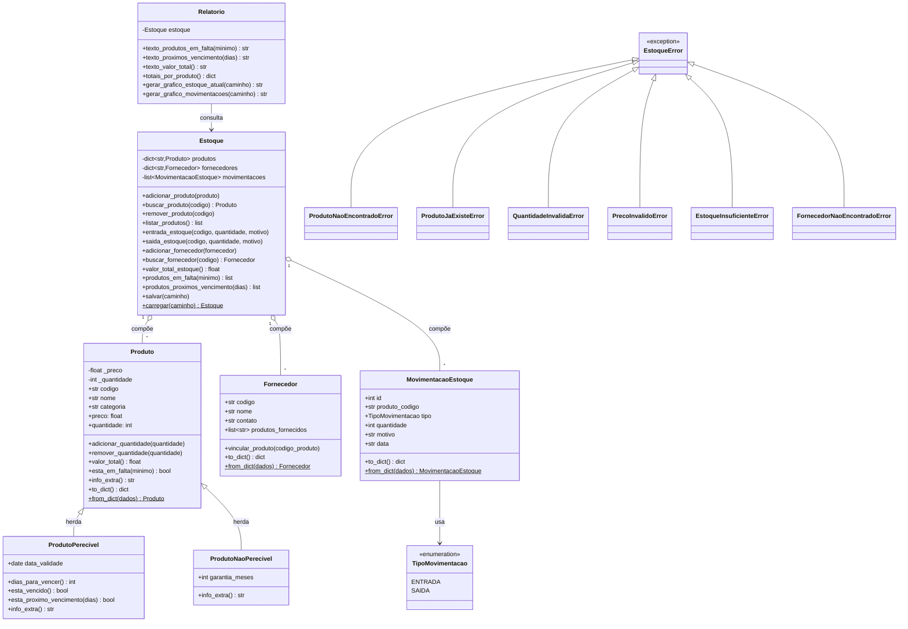

@'
# Diagrama de Classes — Sistema de Controle de Estoque

> O diagrama abaixo está em sintaxe **Mermaid**. Ele é renderizado
> automaticamente no GitHub, no GitLab, no VS Code (com a extensão
> "Markdown Preview Mermaid Support") e em https://mermaid.live
> (basta colar o bloco de código lá para visualizar/exportar como imagem).

## Como explicar este diagrama na apresentação

1. **Herança/Polimorfismo:** `Produto` é a superclasse; `ProdutoPerecivel`
   e `ProdutoNaoPerecivel` sobrescrevem `info_extra()`. Cada um mostra
   uma informação diferente (validade vs. garantia), mesmo método,
   comportamentos diferentes.
2. **Composição:** `Estoque` **é dono** de `Produto`, `Fornecedor` e
   `MovimentacaoEstoque`. Se o objeto `Estoque` deixar de existir, essas
   listas também deixam (não fazem sentido isoladas).
3. **Responsabilidade única:** `Relatorio` não altera dados, apenas lê
   o `Estoque` e produz análises/gráficos, separando "regra de negócio"
   de "apresentação de dados".
4. **Hierarquia de exceções:** todas herdam de `EstoqueError`, o que
   permite tratar qualquer erro do domínio com um único `except EstoqueError`
   na CLI, ou tratar casos específicos separadamente quando necessário.
'@ | Set-Content -Path docs\diagrama_classes.md -Encoding utf8